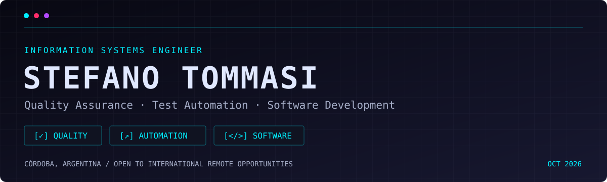
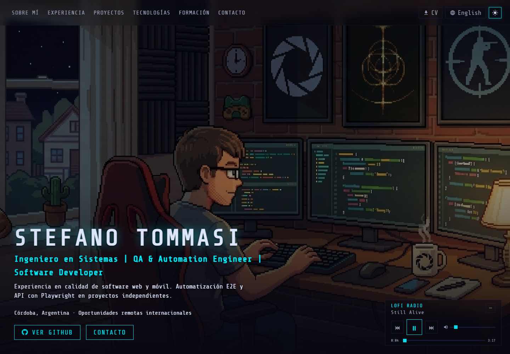

**Information Systems Engineer | QA & Automation Engineer | Software Developer**

Córdoba, Argentina · Open to international remote opportunities

[English CV](https://portfolio-jeinjers-projects.vercel.app/assets/docs/Stefano_Tommasi_EN_CV.pdf) · [CV en español](https://portfolio-jeinjers-projects.vercel.app/assets/docs/Stefano_Tommasi_ES_CV.pdf)

## 👋 About me

I’m Stefano, an **Information Systems Engineer** from Universidad Tecnológica Nacional, Córdoba. My professional foundation is **manual and exploratory QA for web and mobile applications**: investigating defects, validating releases and helping teams understand what went wrong.

I build **independent E2E/API automation projects** with Playwright, TypeScript and Cucumber, and explore performance testing with JMeter. I also develop web applications and use Codex, Claude and Gemini as coding assistants, reviewing and validating their output.

I’m interested in **Quality Engineering, Test Automation and Software Engineering** roles. Based in Argentina, open to international remote work and relocation to Spain with the appropriate work authorization.

## 💼 Experience

- **QA Analyst · TGA** — December 2023–January 2026, full-time remote. Manual and exploratory testing across web, Android and iPad; over **1,000 test cases** and **800 documented defects**. Technical investigation with Chrome DevTools and Android Studio/Logcat; Jira, Confluence and collaboration with development and product teams.
- **Freelance Software Developer · Independent** — January 2026–present. Web applications and e-commerce, responsive interfaces, backend/data integrations and deployment.
- **IT Support Technician · Short Cirkuit** — January 2020–present, on demand. Hardware/software troubleshooting, PC assembly, maintenance and user support.

My test automation experience comes from independent and academic projects; it is separate from my manual QA role at TGA.

## Selected work

| Project | Focus | Context | Source |
| :--- | :--- | :--- | :--- |
| **Short Cirkuit — QA Automation Framework** | Playwright, TypeScript, Cucumber/Gherkin, POM, E2E/API suites and GitHub Actions | Completed independent QA project | [Repository](https://github.com/jeinjer/Short-Cirkuit-Automation-Test) |
| **Automation Lab** | Playwright UI/API checks, JMeter smoke/load plans and CI report artifacts | Completed independent QA project | [Repository](https://github.com/jeinjer/automation_pw_jmeter) |
| **DRIPZONE** | QA planning, functional validation, test design, defect analysis and React frontend | Team engineering capstone; Jest and OWASP ZAP strategies were planned | Private repository |
| **Short Cirkuit — E-commerce** | Responsive React frontend, Express API, Prisma and MongoDB | Web development | [Repository](https://github.com/jeinjer/short-cirkuit-reskin) · [Website](https://www.shortcirkuit.com/) |
| **AI-Polyphite** | Python/FastAPI, Next.js, PostgreSQL, Docker and local Ollama integration | Experimental, AI-assisted learning project; simulated markets | [Repository](https://github.com/jeinjer/ai-polyphite) |

## 🧰 Technical toolkit

| Area | Tools and practices |
| :--- | :--- |
| **QA & software testing** | Exploratory, functional, regression, smoke, retesting, E2E, UAT, test design, defect management, web/mobile, UI/UX and responsive testing |
| **Automation & performance** | Playwright, TypeScript, Cucumber, Gherkin, BDD, Page Object Model, Apache JMeter, GitHub Actions, CI/CD; academic Jest knowledge |
| **API testing & backend** | Postman, Swagger/OpenAPI, REST APIs, HTTP, JSON, Java, Spring Boot, Python, FastAPI |
| **Frontend & databases** | JavaScript, React, Next.js, SQL, PostgreSQL, SQL Server, MongoDB |
| **QA management & diagnostics** | Jira, Confluence, Chrome DevTools, Android Studio, Logcat, Figma; Xray in independent practice |
| **Development workflow** | Git, GitHub, Docker, Scrum, Kanban and agile collaboration |
| **AI-assisted development** | OpenAI Codex, Claude, Gemini — coding, testing, debugging and refactoring with human review |

These span professional experience, independent projects and academic training. Accessibility and cross-browser testing are part of my additional training and practice. AI-Polyphite is an experimental learning project, not professional AI engineering experience.

## 🎓 Education & languages

**Information Systems Engineering · Universidad Tecnológica Nacional, Facultad Regional Córdoba**  
March 2021–March 2026 · Graduated · **GPA: 8.23/10**

- EF SET English Certificate — **65/100**, 2026
- Software Testing — Udemy, 2024
- SQL — Desafío Latam, 2023

**Spanish:** native · **English:** intermediate working proficiency; B1/B2 conversational

## 🕹️ Explore my portfolio

A bilingual portfolio with dark/light pixel-art scenes, an interactive experience map and project details.

**Let’s build software that works.**  
[Portfolio](https://portfolio-jeinjers-projects.vercel.app/) · [LinkedIn](https://www.linkedin.com/in/stefanotommasi15) · [Email](mailto:stefanotommasia5@gmail.com)

Updated October 2026

